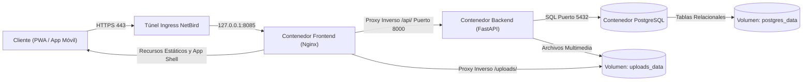

Las aplicaciones web modernas no se construyen simplemente uniendo pantallas visuales, sino coordinando seguridad de red, aislamiento de contenedores, lógica de negocio sin estado y persistencia transaccional. En una etapa donde los asistentes de inteligencia artificial generan código sintáctico en segundos, el éxito de un proyecto ya no depende de memorizar bucles o propiedades de estilo, sino de dominar la arquitectura de sistemas: fronteras del sistema, contratos de interfaz, flujos de datos y modelos relacionales. Tomando la UPA Campus App como caso de estudio real, esta serie de seis capítulos transmite un modelo mental universal sobre cómo funcionan las aplicaciones web modernas y demuestra por qué cada requisito del pliego funcional constituye un plano lógico derivado de la arquitectura.

---

## Visión General del Sistema y Flujo Arquitectónico

Una sola pulsación en el teléfono móvil o en el portal administrativo recorre en milisegundos cuatro capas estrictamente aisladas, desde el túnel de ingreso cifrado hasta el motor de almacenamiento persistente:

---

## Por Qué la Arquitectura y la Especificación Funcional Son Inseparables

En muchos proyectos de software, la especificación funcional se percibe como una lista arbitraria de deseos. En una arquitectura web sólida ocurre exactamente lo contrario: cada regla funcional protege al sistema frente a datos inconsistentes, brechas de seguridad o saturación de recursos.

1. **Red e Identidad Zero-Trust:** El servidor de producción no abre puertos públicos en el enrutador; todo el tráfico entrante viaja por una malla cifrada WireGuard (NetBird) hacia el proxy local Nginx. En la capa de aplicación, esta defensa continúa con el inicio de sesión obligatorio mediante Google OAuth para cuentas institucionales y el principio de privilegio mínimo en la matriz de roles: las cuentas nuevas nacen con todas las casillas de permisos desmarcadas y sin botones de acceso rápido de desarrollo.
2. **Desacoplamiento Estricto de Contenedores y Clientes:** La plataforma separa la entrega estática (Nginx), la lógica de API (FastAPI) y el motor relacional (PostgreSQL) en contenedores independientes. Así, un único backend alimenta tanto al portal editorial de escritorio como a la interfaz móvil estudiantil con soporte offline y sincronización de entregas de Google Classroom.
3. **Fuente Única de Verdad en el Backend:** En lugar de dispersar noticias, eventos de calendario y avisos de emergencia en tablas separadas, un modelo unificado de publicaciones (`/api/publications`) concentra todos los formatos. De esta estructura emanan directamente las reglas del editor: fijar un aviso arriba (`is_pinned`) exige una fecha de vencimiento (`expires_at`) para evitar que alertas meteorológicas caducadas bloqueen el feed de forma permanente. Asimismo, las publicaciones sincronizadas desde Instagram permanecen en modo de solo lectura en el portal editorial porque el proceso periódico de sincronización sobrescribiría cualquier edición manual en su siguiente ciclo.
4. **Persistencia Determinista de Datos:** Los metadatos estructurados, el conteo de lecturas únicas (`PostView`) y las inscripciones en 1 clic (`EventRegistration`) se guardan con garantías ACID en PostgreSQL, mientras que las imágenes, videos y documentos PDF se alojan en un volumen dedicado del host para no saturar la memoria caché de la base de datos.

---
