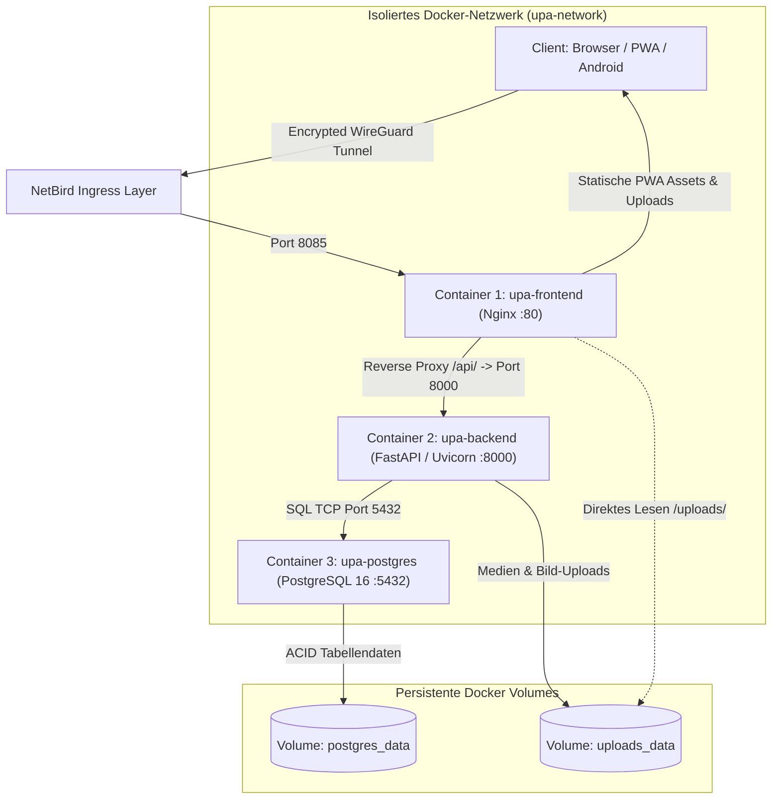
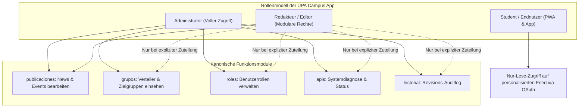
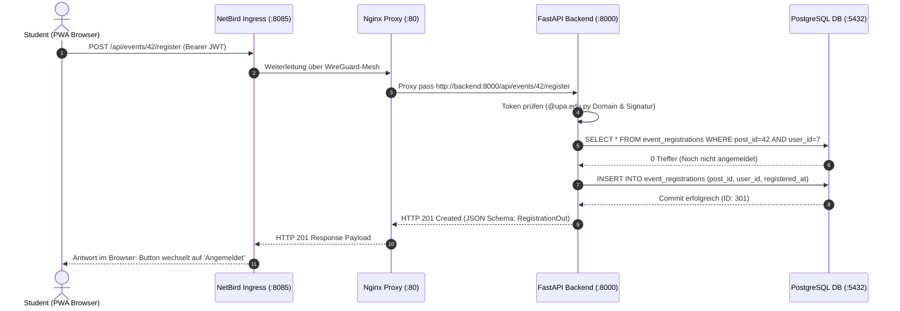
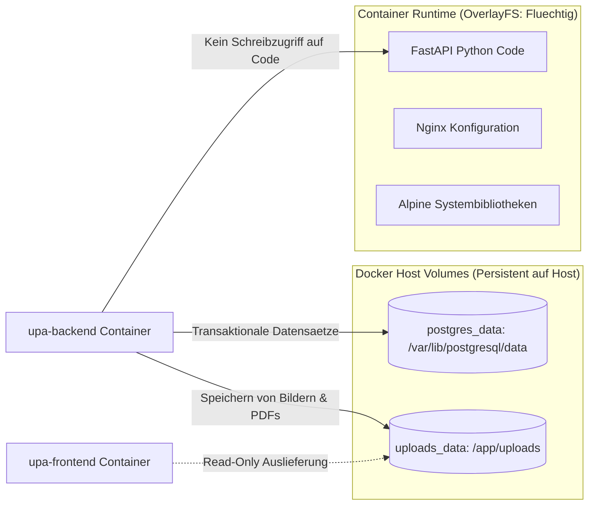
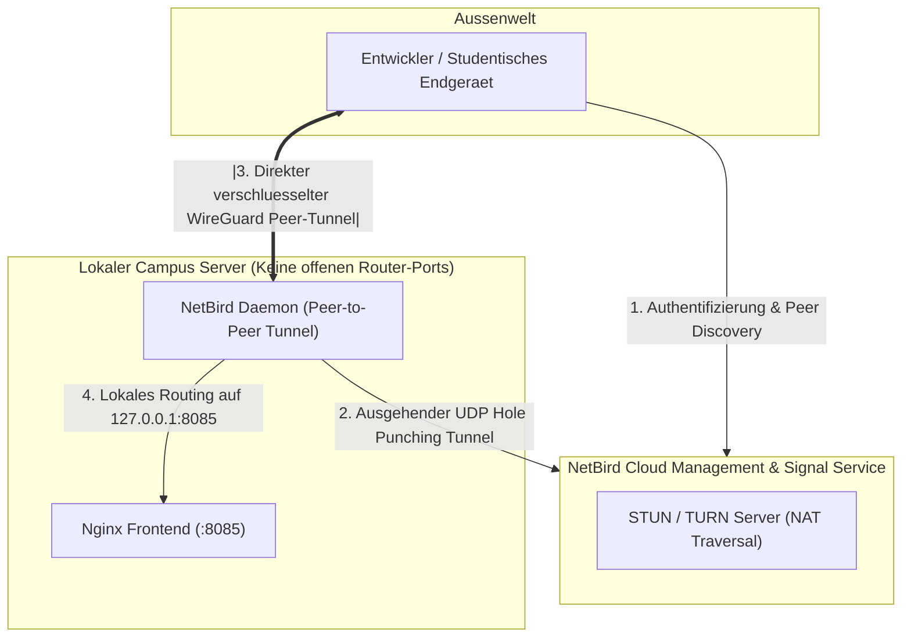
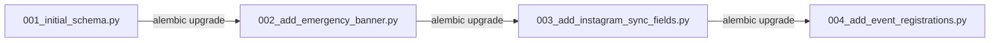

Die UPA Campus App bündelt Ankündigungen, akademische Termine und Event-Registrierungen in einer modularen Drei-Container-Infrastruktur. Dieser Master-Leitfaden dient Studierenden und Entwicklern als zentrales Systemhandbuch: Er verknüpft die Anforderungen des universitären Pflichtenhefts mit konkreten Modulen im Code und dokumentiert den lückenlosen Datenfluss von der Benutzeroberfläche bis zur persistenten Datenbank.

[](#)
[](#)
[](#)
[](#)
[](#)
[](#)

---

<details open>
<summary><strong>Interaktives Inhaltsverzeichnis</strong></summary>

1. [Teil 1: Pflichtteil für Mitstudenten](#teil-1-pflichtteil-für-mitstudenten)
   - [1.1 Big Picture und Gesamtsystem](#11-big-picture-und-gesamtsystem)
   - [1.2 Pflichtenheft-Mapping: Anforderungen und Code-Module](#12-pflichtenheft-mapping-anforderungen-und-code-module)
   - [1.3 Rollen und Rechte: Prinzip des minimalen Privilegs](#13-rollen-und-rechte-prinzip-des-minimalen-privilegs)
   - [1.4 Der Live-Durchstich: Vom Klick bis zum PostgreSQL-Commit](#14-der-live-durchstich-vom-klick-bis-zum-postgresql-commit)
2. [Teil 2: Freiwillige Vertiefung](#teil-2-freiwillige-vertiefung)
   - [2.1 Docker Host Volumes vs Containerspeicher](#21-docker-host-volumes-vs-containerspeicher)
   - [2.2 NetBird WireGuard Ingress Details](#22-netbird-wireguard-ingress-details)
   - [2.3 Pydantic Schema-Validierung und Alembic Migrationen](#23-pydantic-schema-validierung-und-alembic-migrationen)
3. [Fazit](#fazit)

</details>

---

## Teil 1: Pflichtteil für Mitstudenten

### 1.1 Big Picture und Gesamtsystem

Die Systemarchitektur der UPA Campus App trennt Präsentation, Applikationslogik und Datenhaltung strikt in drei leichtgewichtige Container. Der Zugang von außen erfolgt ohne Portweiterleitungen im Router über ein privates WireGuard-Mesh (NetBird Ingress):



Die Aufgabenverteilung der drei Container im Regelbetrieb:

1. **Frontend-Container (`upa-frontend`):** Auslieferung der vorkompilierten Single-Page-Application (Vue.js / Vite) über Nginx auf Port 80. Nginx fungiert gleichzeitig als Reverse Proxy: Anfragen an den Pfad `/api/` leitet er intern an den Backend-Container weiter. Statische Uploads unter `/uploads/` liefert Nginx direkt aus dem gemeinsamen Volume aus, ohne den Python-Prozess zu belasten.
2. **Backend-Container (`upa-backend`):** REST-Schnittstelle auf Basis von FastAPI und Python 3.11 auf Port 8000. Der Container wickelt die Geschäftslogik ab, validiert Eingaben via Pydantic, prüft Google OAuth Tokens für die Hochschuldomain `@upa.edu.py` und steuert Hintergrundaufgaben (Push-Nachrichten, Synchronisation).
3. **Datenbank-Container (`upa-postgres`):** Relationaler Datenkern mit PostgreSQL 16 Alpine auf Port 5432. Alle Tabellendaten liegen im benannten Volume `postgres_data`. Der Container ist isoliert innerhalb der Docker-Bridge `upa-network` ansprechbar.

---

### 1.2 Pflichtenheft-Mapping: Anforderungen und Code-Module

Die Anforderungen des universitären Pflichtenhefts spiegeln sich direkt in der Ordner- und Modulstruktur des Backends wider:

| Anforderung aus Pflichtenheft | Didaktische Kernfunktion | Code-Modul im Backend | Datenmodell & Tabellen |
| :--- | :--- | :--- | :--- |
| **Notfall-Banner** | Anzeige unvorhergesehener Campus-Lagen (z.B. Unwetter) als priorisierter Banner im Feed | `src/api/publications.py` | `Post.is_emergency`, `Post.emergency_level` |
| **Veranstaltungen anpinnen** | Fixieren relevanter Termine ganz oben im Feed mit zwingendem Ablaufdatum | `src/services/scheduler.py`, `src/api/publications.py` | `Post.pinned`, `Post.pinned_until` |
| **Instagram-Synchronisation** | Automatischer Import von Beiträgen mit Schreibschutz für synchronisierte Felder | `src/services/instagram.py`, `src/api/publications.py` | `Post.instagram_id`, `Post.media_type` |
| **1-Klick-Event-Anmeldung** | Platzreservierung und Stornierung für Konferenzen ohne redundante Formulareingaben | `src/api/events.py` (`/api/events/{id}/register`) | `EventRegistration` (`post_id`, `user_id`) |
| **Akademische Termine** | Import von Abgabefristen und Terminen aus Google Classroom | `src/api/classroom.py`, `src/schemas/classroom.py` | Lokaler Classroom-Cache |
| **Rollen & Rechteverwaltung** | Granulare Rechtevergabe nach dem Prinzip des minimalen Privilegs | `src/permissions.py`, `src/api/roles.py` | `UserRole` (`permissions` JSON-Array) |
| **Zielgruppen-Segmentierung** | Alphabetische Liste realer Google Workspace Gruppen mit Sofortfilter | `src/services/google_groups.py`, `src/api/groups.py` | `AudienceGroup`, `@upa.edu.py`-Cache |
| **Single Source of Truth** | Einheitliches Modell für News, Termine und Mischbeiträge mit Medienanhängen | `src/api/publications.py` | `Post` (Polymorphes Modell) |
| **Revisionssicheres Audit-Log** | Protokollierung administrativer Aktionen zur Nachvollziehbarkeit | `src/services/audit.py`, `src/api/history.py` | `AdminAuditLog` (`action`, `payload`) |
| **Push-Benachrichtigungen** | Zeitgesteuerte Terminerinnerungen (Minuten, Stunden, Tage vor Event) | `src/services/push.py`, `src/services/scheduler.py` | `DeviceToken` (FCM-Token, Device-OS) |

---

### 1.3 Rollen und Rechte: Prinzip des minimalen Privilegs

Die Campus-Plattform trennt Zugriffsrechte strikt nach Verantwortungsbereich. Bei der Neuanlage eines Accounts im Administrationsportal sind standardmäßig sämtliche Berechtigungs-Häkchen deaktiviert (Principle of Least Privilege).



Die drei Berechtigungsstufen im Detail:

1. **Student:** Autorisierung über Google OAuth mit einer verifizierten `@upa.edu.py`-E-Mail-Adresse. Studierende besitzen Nur-Lese-Rechte auf für sie freigegebene Publikationen, können sich mit einem Klick zu Konferenzen an- oder abmelden und ihr eigenes Profil (Dark Mode, Push-Präferenzen) pflegen.
2. **Redakteur (Editor):** Redaktionsmitarbeiter verwalten redaktionelle Inhalte. Ohne zusätzliche Freigabe besitzt ein Redakteur lediglich das Recht `publicaciones`. Zusätzliche administrative Bereiche (`grupos`, `roles`, `apis`, `historial`) bleiben gesperrt, bis ein Administrator diese im Rollenmodul einzeln aktiviert.
3. **Administrator:** Umfasst alle Berechtigungen. Nur Administratoren dürfen Benutzerkonten erstellen, Rollenberechtigungen modifizieren, Systemdiagnosen abrufen und das Audit-Log einsehen.

Im Code erzwingt das Backend diese Prüfung deklarativ über FastAPI-Dependencies:

```python
# src/permissions.py
PERMISSION_KEYS: tuple[str, ...] = (
    "publicaciones", "grupos", "roles", "apis", "historial"
)

def require_permission(permission: str):
    def dependency(
        user: User = Depends(get_current_user),
        db: Session = Depends(get_db)
    ):
        if user.role == "admin":
            return user
        perms = effective_permissions(db, user)
        if permission not in perms:
            raise HTTPException(
                status_code=status.HTTP_403_FORBIDDEN,
                detail=f"Fehlende Berechtigung: {permission}"
            )
        return user
    return dependency
```

---

### 1.4 Der Live-Durchstich: Vom Klick bis zum PostgreSQL-Commit

Was geschieht technisch, wenn eine Studentin in der PWA auf "Zu Konferenz anmelden" klickt? Der lückenlose Ablauf von der Benutzeroberfläche über alle Schichten bis zur Datenbank:



Die einzelnen Teilschritte im Detail:

1. **Client & Ingress:** Der Browser setzt einen HTTPS-Request mit dem Google-OAuth-Token im Header ab. Das Paket läuft durch das NetBird-WireGuard-Overlay direkt zum Campus-Server auf Port 8085.
2. **Reverse Proxy Dispatch:** Nginx erkennt das Pfadpräfix `/api/` und leitet die TCP-Verbindung containerintern über das Docker-Netzwerk an `http://backend:8000` weiter.
3. **Validierung & Autorisierung:** Die FastAPI-Middleware extrahiert das JWT. Der Auth-Service validiert die digitale Signatur gegen den Google-OAuth-Endpunkt und prüft, ob die Domain mit `@upa.edu.py` übereinstimmt.
4. **Geschäftslogik:** Der Event-Service prüft in der Datenbank, ob die maximale Teilnehmerzahl bereits erreicht ist und ob der Nutzer für das Event registriert ist.
5. **Datenbank-Transaktion:** SQLAlchemy öffnet eine Transaktion und setzt das `INSERT`-Statement ab. Ein eindeutiger Unique Constraint auf `(post_id, user_id)` stellt auf Datenbankebene sicher, dass selbst bei doppelten Klicks keine Doppelregistrierung entstehen kann.
6. **Rückmeldung:** Nach erfolgreichem `db.commit()` gibt FastAPI den Statuscode 201 mit den Bestätigungsdaten zurück. Die PWA empfängt das JSON und aktualisiert das UI ohne Neuladen der Seite.

---

## Teil 2: Freiwillige Vertiefung

### 2.1 Docker Host Volumes vs Containerspeicher

Container basieren auf einem mehrschichtigen Union File System (OverlayFS). Jede Schreiboperation innerhalb der Container-Dateischicht erzeugt einen Copy-on-Write-Overhead: Daten in dieser flüchtigen Schicht werden beim Neustart oder Austausch des Containers unwiderruflich gelöscht.

Für eine unternehmensrelevante Campus-Lösung verlangt die Datenhaltung deshalb eine saubere Trennung:



In der Praxis nutzt die UPA Campus App zwei benannte Volumes (`named volumes`):

* `postgres_data`: Dieses Volume bindet das Verzeichnis `/var/lib/postgresql/data` an das Dateisystem des Docker-Hosts. Selbst wenn der Datenbank-Container für Updates neu erzeugt wird, bleibt die Datenbank unverändert erhalten.
* `uploads_data`: Dieses Volume speichert hochgeladene Dateien (Bilder für Veranstaltungsankündigungen, PDFs für Dokumente). Der Backend-Container besitzt Schreibrechte, während der Nginx-Container Lesezugriff hat, um Mediendateien unter `/uploads/` direkt per HTTP auszuliefern.

---

### 2.2 NetBird WireGuard Ingress Details

Herkömmliche Server-Deployments verlangen Portweiterleitungen im lokalen Router und eine statische öffentliche IP-Adresse. In universitären Umgebungen ist dies aus Sicherheitsgründen oft nicht realisierbar: Eingehende Ports sind gesperrt, und Router nutzen symmetrisches NAT.

NetBird löst diese Einschränkung durch ein softwaredefiniertes WireGuard-Overlay:



Die technischen Kernmechanismen:

1. **Ausgehende Verbindungen:** Der lokale NetBird-Daemon initiiert den Verbindungsaufbau stets ausgehend zu den Koordinationsservern. Firewalls und NAT-Gateways des Universitätsnetzes blockieren diese Verbindungen nicht.
2. **ICE & UDP Hole Punching:** Mittels STUN- und TURN-Protokollen ermitteln die Peers ihre öffentlichen Verbindungspfade und handeln einen direkten, punkt-zu-punkt verschlüsselten WireGuard-Tunnel aus.
3. **Kernel-Verschlüsselung:** Der Datenverkehr wird über ChaCha20-Poly1305 auf Netzwerkebene verschlüsselt. Angreifer im selben lokalen WLAN-Netz können den Datenfluss weder einsehen noch manipulieren.

---

### 2.3 Pydantic Schema-Validierung und Alembic Migrationen

Ein stabiler Backend-Betrieb erfordert strikte Typsicherheit bei Datenübertragungen und reproduzierbare Datenbankschemata.

#### Pydantic Schema-Validierung

FastAPI nutzt Pydantic für die Eingangs- und Ausgangsvalidierung. Fehlerhafte Anfragen (z.B. ungültige Datumsformate oder fehlende Pflichtfelder) weist das Framework sofort mit HTTP 422 Unprocessable Entity ab, noch bevor Datenbankabfragen ausgeführt werden:

```python
# src/schemas/publication.py
from datetime import datetime
from pydantic import BaseModel, Field

class PublicationCreate(BaseModel):
    title: str = Field(..., min_length=3, max_length=255)
    content: str = Field(..., min_length=1)
    is_emergency: bool = False
    pinned: bool = False
    pinned_until: datetime | None = None
    media_url: str | None = None

class PublicationOut(PublicationCreate):
    id: int
    created_at: datetime
    views_count: int = 0

    class Config:
        from_attributes = True
```

#### Schema-Migrationen mit Alembic

Tabellenschemata verändern sich im Lebenszyklus einer Anwendung. Manuelle SQL-Befehle (`ALTER TABLE`) bergen das Risiko von Schema-Inkonsistenzen und Datenverlust. Alembic versioniert Schema-Änderungen in chronologischen Migrationsskripten:



Vor dem Start des Backends führt der Container automatisch `alembic upgrade head` aus. So ist gewährleistet, dass Testumgebungen und Produktionsdatenbanken stets denselben deterministischen Stand aufweisen.

---

## Fazit

Zwei Grundprinzipien prägen die Architektur der UPA Campus App:

1. **Schlanke Modularität schlägt Komplexität:** Die Aufteilung in drei spezialisierte Container für Nginx, FastAPI und PostgreSQL garantiert Stabilität und Wartbarkeit ohne überdimensionierten Betriebsaufwand.
2. **Sicherheit durch Design:** Der NetBird-Ingress-Tunnel und ein konsequent umgesetztes Least-Privilege-Rollenmodell schützen das Universitätssystem zuverlässig vor Fehlkonfigurationen und externen Angriffen.
