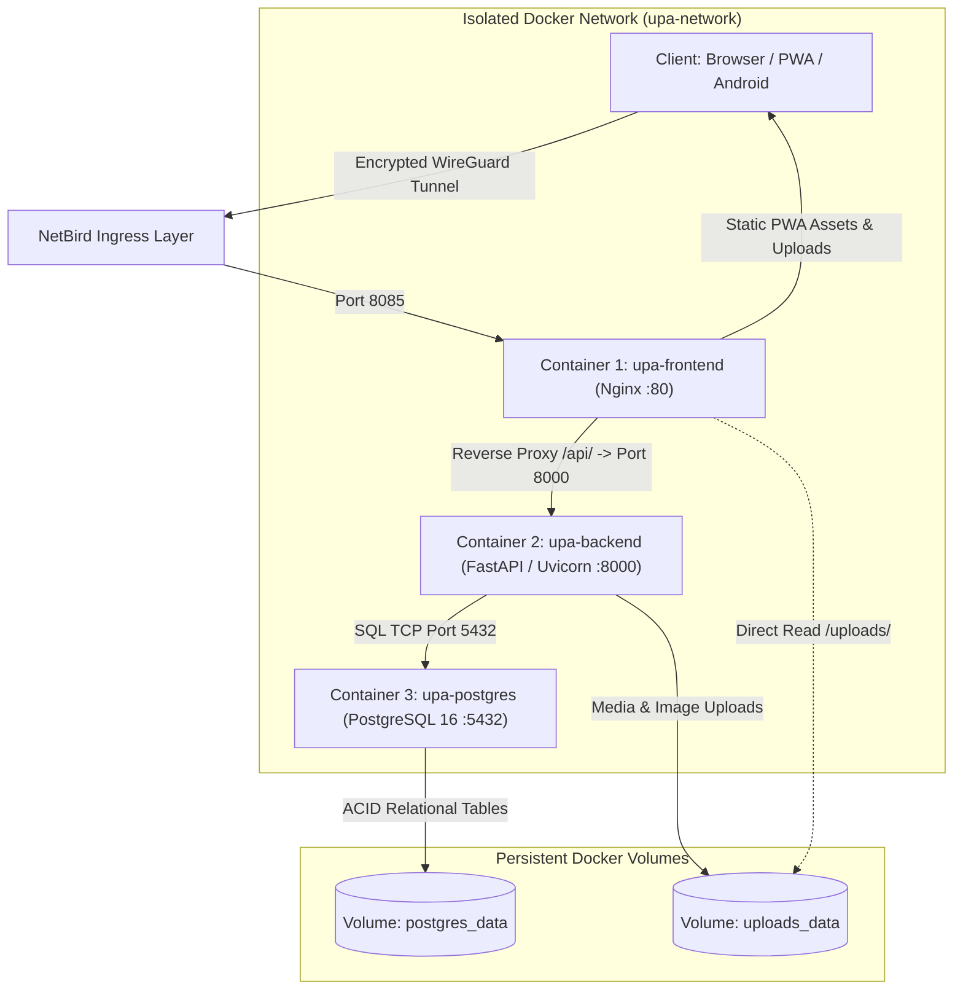
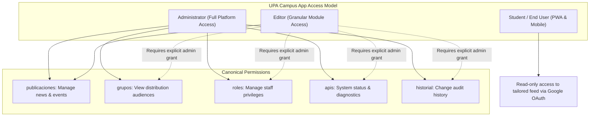
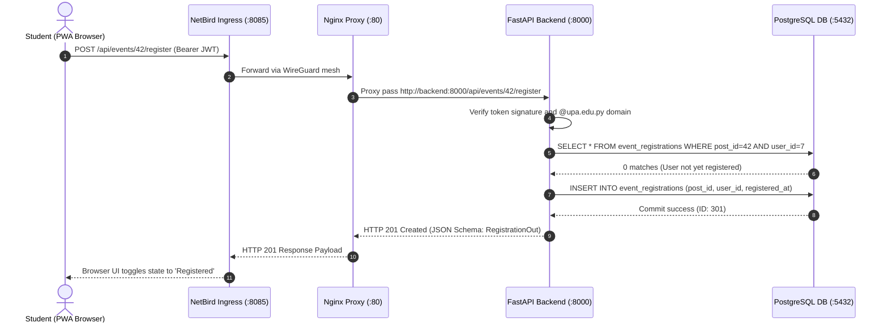
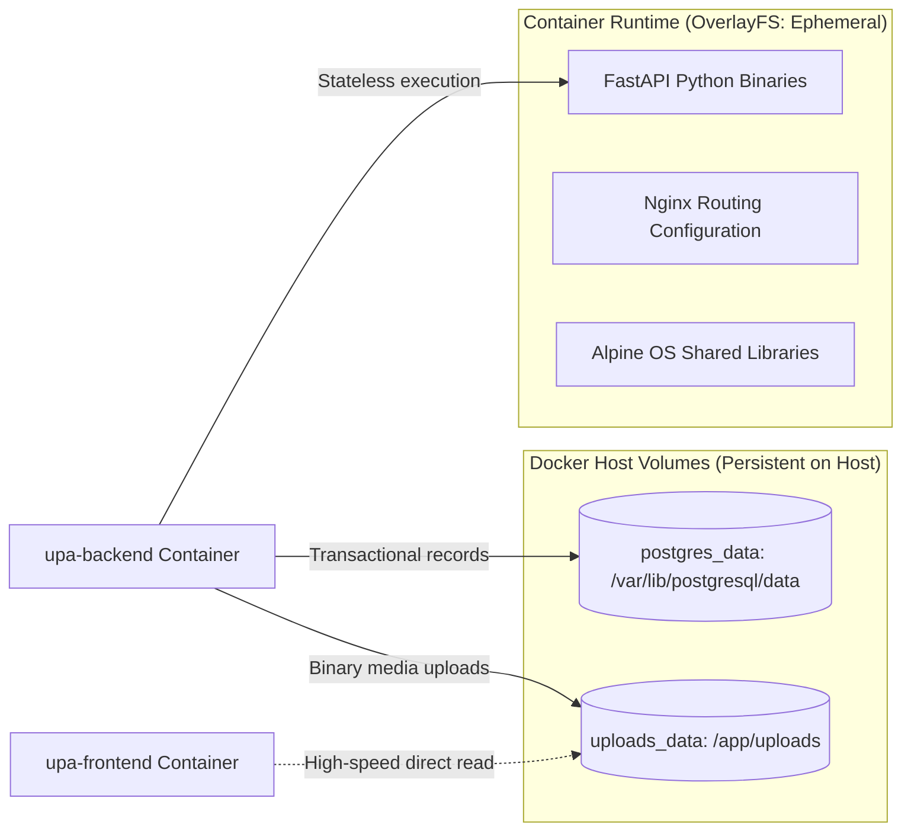
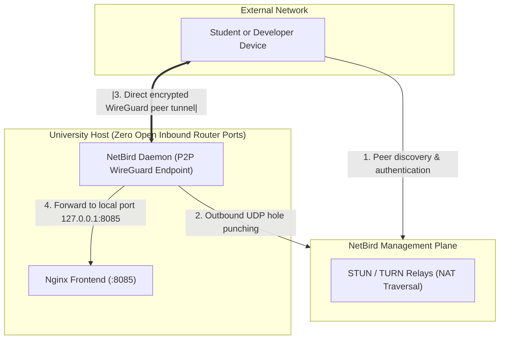
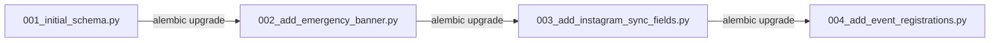

The UPA Campus App consolidates campus announcements, academic deadlines, and event registrations into a modular three-container infrastructure. This master manual serves students and software engineers as a central architecture reference: it maps core functional specifications to backend code modules and documents the end-to-end data flow from client interactions to persistent storage.

[](#)
[](#)
[](#)
[](#)
[](#)
[](#)

---

<details open>
<summary><strong>Interactive Table of Contents</strong></summary>

1. [Part 1: Core Curriculum for Fellow Students](#part-1-core-curriculum-for-fellow-students)
   - [1.1 Big Picture and Overall System](#11-big-picture-and-overall-system)
   - [1.2 Specifications Mapping: Requirements and Code Modules](#12-specifications-mapping-requirements-and-code-modules)
   - [1.3 Roles and Permissions: Principle of Least Privilege](#13-roles-and-permissions-principle-of-least-privilege)
   - [1.4 The Live End-to-End Walkthrough: From Click to PostgreSQL Commit](#14-the-live-end-to-end-walkthrough-from-click-to-postgresql-commit)
2. [Part 2: Advanced Engineering Deep Dive](#part-2-advanced-engineering-deep-dive)
   - [2.1 Docker Host Volumes vs Ephemeral Container Storage](#21-docker-host-volumes-vs-ephemeral-container-storage)
   - [2.2 NetBird WireGuard Ingress Details](#22-netbird-wireguard-ingress-details)
   - [2.3 Pydantic Schema Validation and Alembic Migrations](#23-pydantic-schema-validation-and-alembic-migrations)
3. [Conclusion](#conclusion)

</details>

---

## Part 1: Core Curriculum for Fellow Students

### 1.1 Big Picture and Overall System

The UPA Campus App architecture decouples user interface delivery, business application logic, and data storage into three isolated containers. External communication bypasses exposed router ports via a private WireGuard overlay mesh (NetBird Ingress):



Component division of labor in production:

1. **Frontend Container (`upa-frontend`):** Distributes the precompiled single-page application (Vue.js / Vite) through Nginx on port 80. Nginx functions as a reverse proxy: requests prefixed with `/api/` route internally to the backend container. Static binary media under `/uploads/` stream directly from the shared volume, eliminating CPU overhead on the Python runtime.
2. **Backend Container (`upa-backend`):** REST API powered by FastAPI and Python 3.11 on port 8000. Handles core business logic, schema validation via Pydantic, Google OAuth token verification for the `@upa.edu.py` domain, and asynchronous background jobs (push messaging, directory synchronization).
3. **Database Container (`upa-postgres`):** Relational data core using PostgreSQL 16 Alpine on port 5432. All structured tables reside in the named volume `postgres_data`. The database is accessible in isolation across the internal Docker bridge `upa-network`.

---

### 1.2 Specifications Mapping: Requirements and Code Modules

The requirements defined in the functional specification map directly to backend modules and database structures:

| Functional Requirement | Core Purpose | Backend Module / API Route | Data Model & Tables |
| :--- | :--- | :--- | :--- |
| **Emergency Banner** | Instant alerts for severe campus conditions (such as severe storms) pinned at the top of the feed | `src/api/publications.py` | `Post.is_emergency`, `Post.emergency_level` |
| **Pinned Events** | Fixing major conferences to the top of the feed with mandatory expiration dates | `src/services/scheduler.py`, `src/api/publications.py` | `Post.pinned`, `Post.pinned_until` |
| **Instagram Sync** | Automated ingestion of official university media with read-only locks on synchronized fields | `src/services/instagram.py`, `src/api/publications.py` | `Post.instagram_id`, `Post.media_type` |
| **1-Click Event Booking** | Direct seat booking and instant cancellation for conferences without redundant form entry | `src/api/events.py` (`/api/events/{id}/register`) | `EventRegistration` (`post_id`, `user_id`) |
| **Academic Timelines** | Synchronization of coursework assignments and deadlines from Google Classroom | `src/api/classroom.py`, `src/schemas/classroom.py` | Local classroom cache |
| **Role-Based Access** | Granular module authorization structured around the principle of least privilege | `src/permissions.py`, `src/api/roles.py` | `UserRole` (`permissions` JSON array) |
| **Audience Segmentation** | Alphabetical directory of verified Google Workspace distribution groups with live search | `src/services/google_groups.py`, `src/api/groups.py` | `AudienceGroup`, `@upa.edu.py` cache |
| **Single Source of Truth** | Unified data schema for articles, calendar dates, and hybrid multimedia publications | `src/api/publications.py` | `Post` (Polymorphic schema) |
| **Audit Log Trail** | Complete tracking of administrative and editorial modifications | `src/services/audit.py`, `src/api/history.py` | `AdminAuditLog` (`action`, `payload`) |
| **Push Notifications** | Automated scheduled reminders prior to academic events (minutes, hours, days) | `src/services/push.py`, `src/services/scheduler.py` | `DeviceToken` (FCM tokens, OS) |

---

### 1.3 Roles and Permissions: Principle of Least Privilege

Access control follows strict privilege minimization. When an administrator creates a new staff profile in the web admin portal, all module permission checkboxes start unselected by default.



The three access levels:

1. **Student:** Authentication requires Google OAuth matching a verified `@upa.edu.py` email. Students hold read permissions on targeted publications, register or cancel conference bookings with one click, and manage local preferences (dark mode, notification categories).
2. **Editor:** Editorial staff manage communications. By default, editors possess only the `publicaciones` permission. Access to administrative areas (`grupos`, `roles`, `apis`, `historial`) remains restricted until an administrator activates those specific permissions.
3. **Administrator:** Unrestricted control over all system functions. Only administrators create user profiles, modify staff roles, inspect API health diagnostics, and audit modification histories.

FastAPI implements this policy via dependency injection:

```python
# src/permissions.py
PERMISSION_KEYS: tuple[str, ...] = (
    "publicaciones", "grupos", "roles", "apis", "historial"
)

def require_permission(permission: str):
    def dependency(
        user: User = Depends(get_current_user),
        db: Session = Depends(get_db)
    ):
        if user.role == "admin":
            return user
        perms = effective_permissions(db, user)
        if permission not in perms:
            raise HTTPException(
                status_code=status.HTTP_403_FORBIDDEN,
                detail=f"Missing required permission: {permission}"
            )
        return user
    return dependency
```

---

### 1.4 The Live End-to-End Walkthrough: From Click to PostgreSQL Commit

Consider what occurs under the hood when a student clicks "Register for Event" within the PWA interface:



Step by step execution:

1. **Client & Ingress:** The browser issues an HTTPS request carrying the Google OAuth token in the authorization header. The packet traverses the NetBird WireGuard overlay directly to host port 8085.
2. **Reverse Proxy Dispatch:** Nginx matches the `/api/` prefix and forwards the TCP connection across the Docker bridge to `http://backend:8000`.
3. **Validation & Authentication:** FastAPI middleware extracts the JWT. The authentication service validates the token signature against Google OAuth endpoints and verifies that the email address ends in `@upa.edu.py`.
4. **Business Constraints:** The event handler verifies available capacity and confirms that no prior registration exists for that student.
5. **Database Transaction:** SQLAlchemy begins a database transaction and executes the `INSERT` statement. A database-level unique constraint on `(post_id, user_id)` guarantees duplicate prevention under concurrent requests.
6. **Confirmation:** Following a successful `db.commit()`, FastAPI returns HTTP 201 with the registration schema. Nginx passes the response through the NetBird tunnel, and the client updates the button state instantly without reloading the page.

---

## Part 2: Advanced Engineering Deep Dive

### 2.1 Docker Host Volumes vs Ephemeral Container Storage

Docker containers execute on top of an ephemeral union file system (OverlayFS). Writes to the container layer involve copy-on-write overhead, and any data saved directly to the container layer is destroyed when containers rebuild.

Enterprise campus solutions require structured storage separation:



The system employs two dedicated named volumes:

* `postgres_data`: Binds `/var/lib/postgresql/data` directly to the host filesystem. Upgrading or redeploying the database container preserves all stored records intact.
* `uploads_data`: Stores binary files (event posters, documentation PDFs). The backend maintains write permissions, whereas Nginx retains read access to deliver `/uploads/` directly to web clients.

---

### 2.2 NetBird WireGuard Ingress Details

Standard hosting setups demand open router ports and static public IP addresses. In university infrastructures, incoming ports are routinely blocked and networks run behind symmetric NAT.

NetBird overcomes these limitations via a software-defined WireGuard mesh:



Key technical mechanics:

1. **Outbound Connections:** The NetBird daemon establishes outbound UDP tunnels toward coordination servers. University NAT firewalls allow outbound stateful traffic by default.
2. **ICE and UDP Hole Punching:** By utilizing STUN and TURN protocols, peers negotiate direct point-to-point tunnels without manual port forwarding.
3. **Kernel-Grade Encryption:** Packets are encrypted with ChaCha20-Poly1305. Network observers on shared campus Wi-Fi networks cannot inspect or tamper with internal communications.

---

### 2.3 Pydantic Schema Validation and Alembic Migrations

Production stability requires data contract enforcement and version-controlled schema evolution.

#### Pydantic Schema Validation

FastAPI leverages Pydantic models for request ingestion and response serialization. Invalid payloads trigger automatic HTTP 422 Unprocessable Entity responses before database queries execute:

```python
# src/schemas/publication.py
from datetime import datetime
from pydantic import BaseModel, Field

class PublicationCreate(BaseModel):
    title: str = Field(..., min_length=3, max_length=255)
    content: str = Field(..., min_length=1)
    is_emergency: bool = False
    pinned: bool = False
    pinned_until: datetime | None = None
    media_url: str | None = None

class PublicationOut(PublicationCreate):
    id: int
    created_at: datetime
    views_count: int = 0

    class Config:
        from_attributes = True
```

#### Alembic Schema Migrations

Database tables change across release cycles. Uncontrolled `ALTER TABLE` queries risk schema divergence and downtime. Alembic tracks structural modifications in versioned migration files:



During container initialization, the system executes `alembic upgrade head`, ensuring staging and production databases remain synchronized.

---

## Conclusion

Two core architectural tenets underpin the UPA Campus App:

1. **Focused modularity beats complexity:** Isolating responsibilities across Nginx, FastAPI, and PostgreSQL delivers high availability and low administrative overhead.
2. **Security by design:** NetBird ingress tunnels and strict least-privilege role separation protect internal campus resources against misconfiguration and unauthorized network access.
