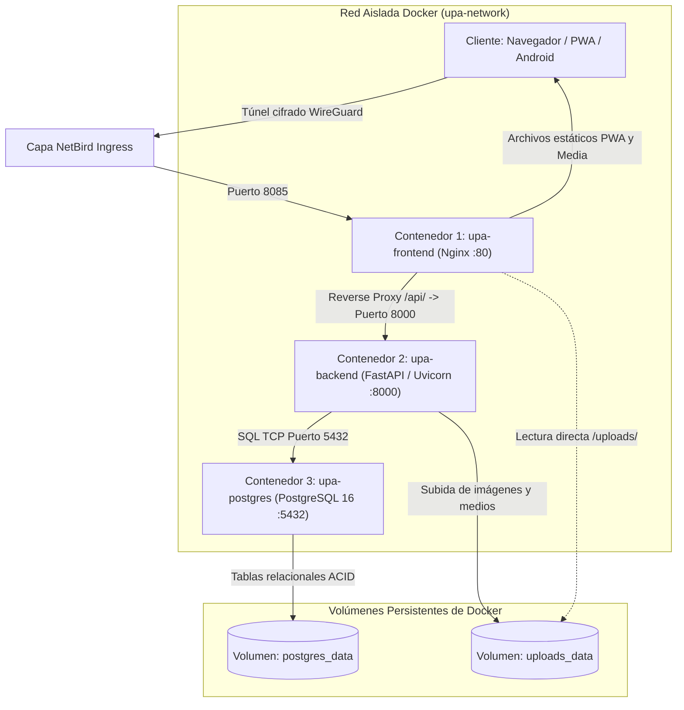
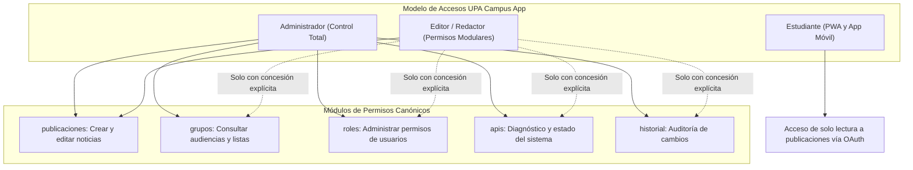
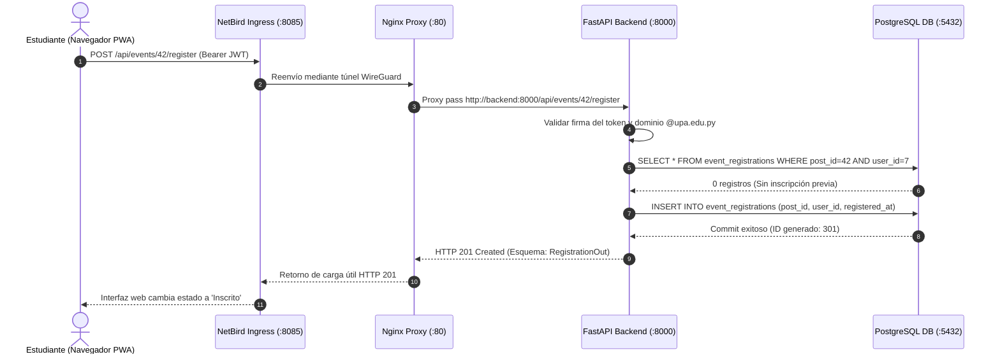
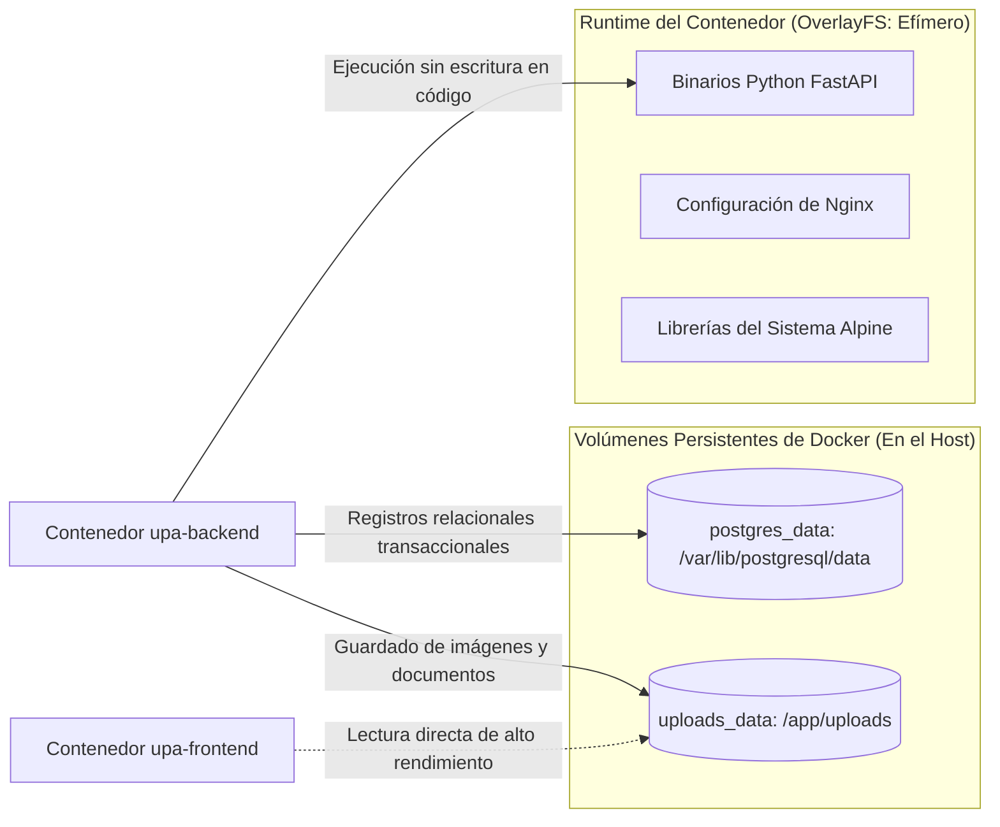
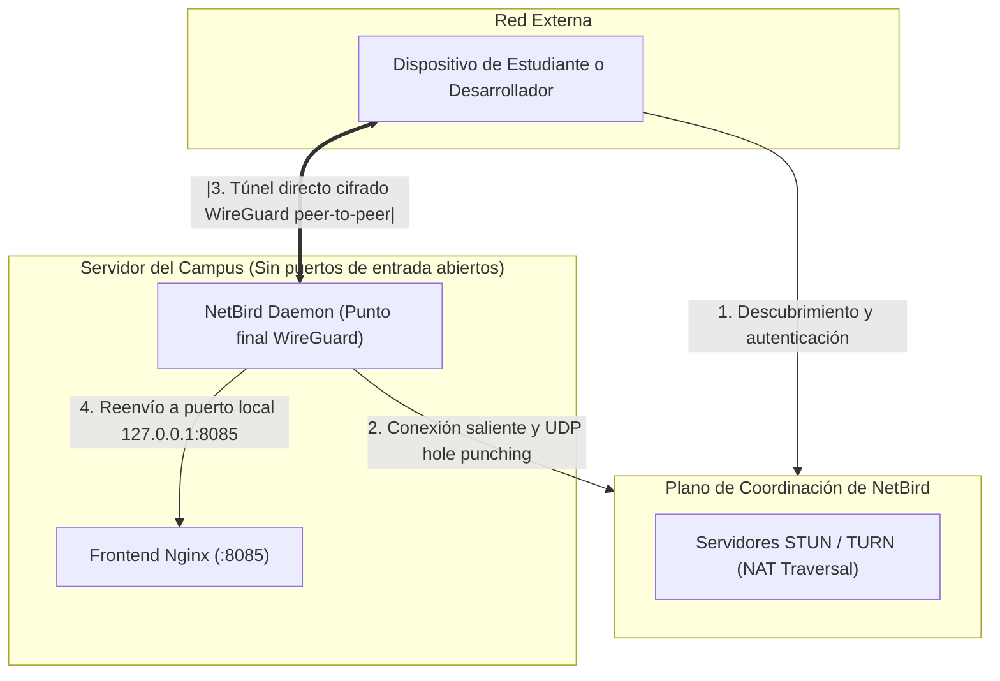
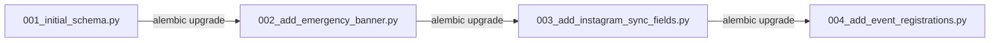

La UPA Campus App consolida avisos del campus, fechas académicas e inscripciones a eventos dentro de una infraestructura modular de tres contenedores. Este manual maestro sirve a estudiantes e ingenieros como referencia central de arquitectura: vincula las especificaciones funcionales con los módulos de código y documenta el flujo de datos integral desde la interfaz web hasta la persistencia relacional.

[](#)
[](#)
[](#)
[](#)
[](#)
[](#)

---

<details open>
<summary><strong>Índice Interactivo</strong></summary>

1. [Parte 1: Sección Obligatoria para Compañeros de Estudio](#parte-1-sección-obligatoria-para-compañeros-de-estudio)
   - [1.1 Visión General y Sistema Integral](#11-visión-general-y-sistema-integral)
   - [1.2 Mapeo del Pliego de Requisitos: Funcionalidades y Código](#12-mapeo-del-pliego-de-requisitos-funcionalidades-y-código)
   - [1.3 Roles y Permisos: Principio de Privilegio Mínimo](#13-roles-y-permisos-principio-de-privilegio-mínimo)
   - [1.4 El Recorrido en Vivo: Desde el Clic hasta el Commit en PostgreSQL](#14-el-recorrido-en-vivo-desde-el-clic-hasta-el-commit-en-postgresql)
2. [Parte 2: Profundización Técnica Voluntaria](#parte-2-profundización-técnica-voluntaria)
   - [2.1 Volúmenes Host de Docker vs Almacenamiento Efímero](#21-volúmenes-host-de-docker-vs-almacenamiento-efímero)
   - [2.2 Detalles de Ingress WireGuard con NetBird](#22-detalles-de-ingress-wireguard-con-netbird)
   - [2.3 Validación de Esquemas con Pydantic y Migraciones con Alembic](#23-validación-de-esquemas-con-pydantic-y-migraciones-con-alembic)
3. [Conclusión](#conclusión)

</details>

---

## Parte 1: Sección Obligatoria para Compañeros de Estudio

### 1.1 Visión General y Sistema Integral

La arquitectura de la UPA Campus App desacopla la presentación visual, la lógica de negocio y el almacenamiento de datos en tres contenedores ligeros. El acceso externo se realiza sin abrir puertos en el router mediante una malla privada de WireGuard (NetBird Ingress):



Distribución operativa de los tres contenedores:

1. **Contenedor Frontend (`upa-frontend`):** Entrega la Single Page Application precompilada (Vue.js / Vite) mediante Nginx en el puerto 80. Nginx actúa como reverse proxy: las solicitudes bajo la ruta `/api/` se reenvían al contenedor backend. Los archivos subidos en `/uploads/` se sirven directamente desde el volumen compartido sin sobrecargar el proceso de Python.
2. **Contenedor Backend (`upa-backend`):** API REST implementada con FastAPI y Python 3.11 en el puerto 8000. Gestiona la lógica de negocio, valida datos de entrada con Pydantic, verifica tokens de Google OAuth restringidos al dominio `@upa.edu.py` y coordina tareas en segundo plano (notificaciones push, sincronización).
3. **Contenedor de Base de Datos (`upa-postgres`):** Núcleo relacional con PostgreSQL 16 Alpine en el puerto 5432. Los datos estructurados residen en el volumen nombrado `postgres_data`. El contenedor opera de forma aislada dentro del bridge interno `upa-network`.

---

### 1.2 Mapeo del Pliego de Requisitos: Funcionalidades y Código

Los requerimientos del pliego funcional universitario se corresponden directamente con los módulos de código del backend:

| Requisito Funcional | Función Didáctica Principal | Módulo de Código / Endpoint | Modelo de Datos y Tablas |
| :--- | :--- | :--- | :--- |
| **Aviso de Emergencia** | Notificación destacada superior ante imprevistos climáticos o suspensiones | `src/api/publications.py` | `Post.is_emergency`, `Post.emergency_level` |
| **Fijar Publicaciones** | Fijación prioritaria de eventos clave con fecha de vigencia obligatoria | `src/services/scheduler.py`, `src/api/publications.py` | `Post.pinned`, `Post.pinned_until` |
| **Sincronización Instagram** | Importación automática de publicaciones con bloqueo de edición en campos sincronizados | `src/services/instagram.py`, `src/api/publications.py` | `Post.instagram_id`, `Post.media_type` |
| **Inscripción en 1 Clic** | Registro y cancelación instantánea de cupos para conferencias sin formularios repetitivos | `src/api/events.py` (`/api/events/{id}/register`) | `EventRegistration` (`post_id`, `user_id`) |
| **Fechas Académicas** | Sincronización de entregas y plazos formativos desde Google Classroom | `src/api/classroom.py`, `src/schemas/classroom.py` | Caché local de Classroom |
| **Control de Roles** | Asignación granular basada en el principio de menor privilegio | `src/permissions.py`, `src/api/roles.py` | `UserRole` (array JSON `permissions`) |
| **Segmentación de Audiencias** | Directorio ordenado alfabéticamente de grupos de Google Workspace con filtro en tiempo real | `src/services/google_groups.py`, `src/api/groups.py` | `AudienceGroup`, caché `@upa.edu.py` |
| **Fuente Única de Verdad** | Esquema unificado para noticias, fechas de calendario y publicaciones multimedia | `src/api/publications.py` | `Post` (Modelo polimórfico) |
| **Registro de Auditoría** | Trazabilidad completa de modificaciones administrativas y editoriales | `src/services/audit.py`, `src/api/history.py` | `AdminAuditLog` (`action`, `payload`) |
| **Notificaciones Push** | Recordatorios programados con anticipación (minutos, horas, días antes del evento) | `src/services/push.py`, `src/services/scheduler.py` | `DeviceToken` (Tokens FCM, OS) |

---

### 1.3 Roles y Permisos: Principio de Privilegio Mínimo

El modelo de seguridad aplica el principio de menor privilegio. Al registrar una nueva cuenta en el panel administrativo, todas las casillas de verificación de permisos comienzan desmarcadas.



Los tres niveles de acceso:

1. **Estudiante:** Acceso validado mediante Google OAuth con dirección de correo `@upa.edu.py`. Posee permisos de solo lectura sobre publicaciones dirigidas a su carrera, puede inscribirse o cancelar su asistencia a eventos con un clic y gestionar sus preferencias personales.
2. **Editor:** Personal encargado de la redacción. Por defecto, solo cuenta con el permiso `publicaciones`. Las secciones adicionales (`grupos`, `roles`, `apis`, `historial`) permanecen bloqueadas hasta que un administrador las habilita individualmente.
3. **Administrador:** Acceso irrestricto. Es el único perfil facultado para crear cuentas de usuario, configurar permisos de roles, ejecutar diagnósticos de APIs e inspeccionar el historial de auditoría.

El backend aplica estas restricciones mediante inyección de dependencias en FastAPI:

```python
# src/permissions.py
PERMISSION_KEYS: tuple[str, ...] = (
    "publicaciones", "grupos", "roles", "apis", "historial"
)

def require_permission(permission: str):
    def dependency(
        user: User = Depends(get_current_user),
        db: Session = Depends(get_db)
    ):
        if user.role == "admin":
            return user
        perms = effective_permissions(db, user)
        if permission not in perms:
            raise HTTPException(
                status_code=status.HTTP_403_FORBIDDEN,
                detail=f"Permiso requerido no asignado: {permission}"
            )
        return user
    return dependency
```

---

### 1.4 El Recorrido en Vivo: Desde el Clic hasta el Commit en PostgreSQL

Proceso técnico que se desencadena cuando un estudiante pulsa "Inscribirme al Evento" en la PWA:



Etapas de la ejecución:

1. **Cliente e Ingress:** La aplicación web emite una petición HTTPS incluyendo el token JWT de Google OAuth en los encabezados. La solicitud viaja por el overlay de WireGuard hasta el puerto 8085 del host.
2. **Enrutamiento por Reverse Proxy:** Nginx detecta el prefijo `/api/` y canaliza la conexión dentro de la red Docker hacia `http://backend:8000`.
3. **Validación y Autenticación:** El middleware de FastAPI analiza el JWT, verifica la firma criptográfica contra los servidores de Google y comprueba que el correo pertenezca al dominio `@upa.edu.py`.
4. **Lógica de Dominio:** El servicio comprueba la disponibilidad de plazas y certifica que el usuario no cuente con una inscripción previa activa.
5. **Persistencia Transaccional:** SQLAlchemy ejecuta la instrucción `INSERT`. La restricción de unicidad sobre las columnas `(post_id, user_id)` previene registros duplicados en condiciones de concurrencia.
6. **Confirmación al Cliente:** Tras el `db.commit()`, FastAPI retorna el código HTTP 201 con el esquema Pydantic correspondiente. Nginx retorna la respuesta a través del túnel y la interfaz actualiza el botón de inmediato.

---

## Parte 2: Profundización Técnica Voluntaria

### 2.1 Volúmenes Host de Docker vs Almacenamiento Efímero

Los contenedores ejecutan sus procesos sobre un sistema de archivos en capas (OverlayFS). Cualquier modificación en la capa de escritura del contenedor añade sobrecarga de copia en escritura y se destruye si el contenedor se recrea.

El entorno de producción separa el almacenamiento persistente del código:



Se definen dos volúmenes específicos:

* `postgres_data`: Asocia `/var/lib/postgresql/data` al almacenamiento del host. Al actualizar la imagen de la base de datos o reiniciar el servicio, los datos no sufren pérdidas.
* `uploads_data`: Almacena archivos binarios como afiches de actividades o manuales PDF. El backend tiene permisos de escritura y Nginx acceso de lectura directa para distribuir `/uploads/`.

---

### 2.2 Detalles de Ingress WireGuard con NetBird

Las implementaciones habituales exigen abrir puertos en el enrutador y poseer una dirección IP pública fija. En entornos académicos protegidos, los cortafuegos bloquean puertos entrantes y emplean NAT simétrico.

NetBird resuelve este escenario construyendo una red mallada de WireGuard gestionada por software:



Principios técnicos de operación:

1. **Conexiones Salientes:** El servicio NetBird en el servidor inicia comunicaciones hacia afuera hacia los servidores de control. Los cortafuegos del campus permiten el tráfico saliente por defecto.
2. **ICE y UDP Hole Punching:** Los clientes descubren sus trayectorias mediante STUN y TURN para negociar enlaces directos punto a punto sin requerir apertura de puertos.
3. **Cifrado de Nivel de Kernel:** Las tramas se aseguran con ChaCha20-Poly1305. Ningún tercero conectado a la red local puede interceptar o alterar el tráfico.

---

### 2.3 Validación de Esquemas con Pydantic y Migraciones con Alembic

La integridad operativa requiere validación estricta de datos y evolución controlada del modelo de datos.

#### Validación de Esquemas con Pydantic

FastAPI utiliza modelos de Pydantic para la serialización y la entrada de datos. Cualquier parámetro fuera de formato produce una respuesta HTTP 422 Unprocessable Entity antes de tocar la base de datos:

```python
# src/schemas/publication.py
from datetime import datetime
from pydantic import BaseModel, Field

class PublicationCreate(BaseModel):
    title: str = Field(..., min_length=3, max_length=255)
    content: str = Field(..., min_length=1)
    is_emergency: bool = False
    pinned: bool = False
    pinned_until: datetime | None = None
    media_url: str | None = None

class PublicationOut(PublicationCreate):
    id: int
    created_at: datetime
    views_count: int = 0

    class Config:
        from_attributes = True
```

#### Migraciones con Alembic

Las estructuras de tablas evolucionan a lo largo del tiempo. Ejecutar sentencias `ALTER TABLE` manuales genera inconsistencias entre entornos. Alembic versiona estos cambios mediante archivos de migración:



Al inicializarse el contenedor, el sistema ejecuta de forma automática `alembic upgrade head`, sincronizando el esquema con la versión esperada.

---

## Conclusión

Dos principios definen la arquitectura de la UPA Campus App:

1. **La simplicidad modular supera la complejidad:** Separar tareas entre Nginx, FastAPI y PostgreSQL proporciona alta resiliencia y mínimo esfuerzo operativo.
2. **Seguridad integrada en el diseño:** El ingreso mediante NetBird y la división rigurosa de roles resguardan la infraestructura universitaria frente a fallas o accesos no autorizados.
